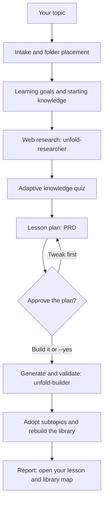
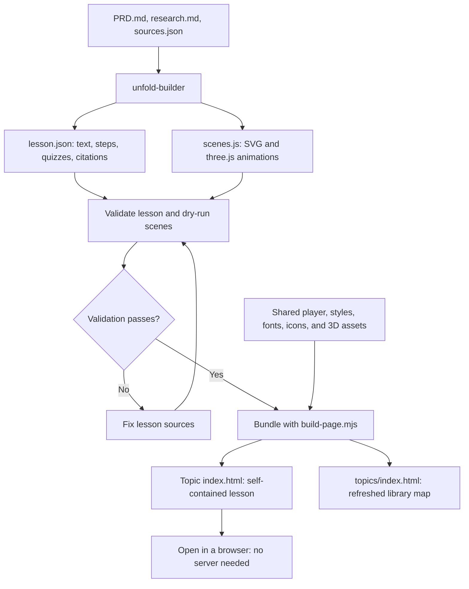
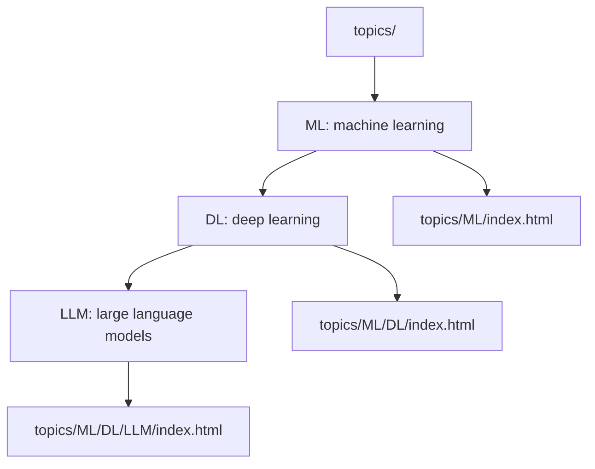

# Unfold

Turn a topic into a self-contained, animated lesson tailored to what you already know.

Unfold is a collection of AI agent instructions, reusable skills, and Node.js build scripts. It runs inside Claude Code, GitHub Copilot, or Codex, rather than as a standalone web app. The result is a local HTML page you can open in a browser without a server.

## What does it do?

Give Unfold a topic such as **Stacks**, **LLM**, or **How do planes fly**. It:

- Asks about your learning goal and starting knowledge.
- Researches the topic using web sources and keeps citations.
- Quizzes you one question at a time to identify gaps.
- Plans a 30-minute or 2-hour lesson pitched at your level.
- Builds animated explanations, step-by-step narration, and knowledge checks.
- Organises the lesson in a topic library with parent topics, prerequisites, and suggested next topics.

### What you get

Each lesson includes an animated stage, cited narration, and these tabs:

| Duration | Content |
|---|---|
| 30 minutes | ELI5, Core Mechanism, Technical, Check Yourself, Related & Sources |
| 2 hours | Everything above, plus Deep Dive, Playground, Story & Misconceptions, Trade-offs, and Cheatsheet |

Scenes use isometric SVG diagrams or three.js for spatial explanations, with SVG fallbacks when WebGL is unavailable.

The generated page bundles its player, styles, fonts, lesson content, and scene code. **Reading a built lesson needs no installation or network connection**; following external source links does.

Try the included [Stacks lesson](topics/Stacks/index.html) or [How Do Planes Fly lesson](topics/How-Do-Planes-Fly/index.html). Open the [library map](topics/index.html) to browse all lessons: click a node for details or double-click to open it. Faint nodes represent suggested topics that have not been built yet.

## How does it work?

The [Unfold workflow](.agents/skills/unfold/SKILL.md) coordinates the following phases:



1. **Intake and placement:** Find an existing lesson or choose a folder for a new one. Existing lessons can be upgraded, regenerated, or rebuilt from their plan; unfinished runs can be resumed.
2. **Probe:** Ask why you are learning the topic and where you are starting from.
3. **Research:** The `unfold-researcher` agent opens web sources and writes a cited research brief and source list. Lessons require at least 8 sources for 30 minutes or 20 for 2 hours; research must not be substituted with model memory.
4. **Knowledge quiz:** The main agent asks adaptive, multiple-choice questions and marks concepts as unknown, shaky, or solid.
5. **Lesson plan:** Write a PRD (the lesson specification) covering objectives, level, tabs, scenes, and folder placement. You approve it before the build.
6. **Build:** The `unfold-builder` agent writes lesson data and animations, then uses the shared player to produce one HTML file. Validation checks structure, tab order, step budgets, narration length, citations, and quizzes, and dry-runs scenes to catch runtime errors.
7. **Library rebuild:** Move any existing subtopics under their new parent and rebuild pages so breadcrumbs, child links, and the library graph stay current.

The main agent handles all questions. Research and build agents receive fresh contexts with only the files they need; if the host cannot launch subagents, the main agent runs those skills itself.

Intermediate files and phase state are saved alongside the lesson, making the process inspectable and the lesson rebuildable.

### From lesson sources to a browser page

The AI agents write the content and scenes; the build scripts validate and bundle them with the reusable player.



## How to run

### Prerequisites

**To generate or rebuild lessons:**

- Node.js 18 or newer. The build scripts need no npm package installation.
- Claude Code, GitHub Copilot (VS Code agent mode or CLI), or Codex CLI, configured and available in this workspace.
- Web search and page-fetching tools enabled for lesson research.
- Permission for the agent to read/write project files and run build commands.

**To read existing lessons:** a modern browser with JavaScript enabled.

### 1. Open the project

Download or clone this repository, then open its root folder in your chosen tool. Run shell commands below from that folder.

Agent definitions for the supported tools are included. If you change an agent or skill, refresh the generated definitions:

```sh
node scripts/sync-agents.mjs
```

### 2. Start Unfold with a topic

| Tool | How to start |
|---|---|
| Claude Code | Run `claude --agent unfold`, then type a topic; alternatively use `/unfold "Stacks"` in a session. |
| GitHub Copilot (VS Code agent mode / CLI) | Select **unfold** in the agent picker, then type a topic. |
| Codex CLI | Start with web search enabled, for example `codex --search`, then enter `$unfold "Stacks"`. |

Example input for the selected agent:

```text
Stacks
```

You can also specify duration and skip the lesson-plan approval:

```text
Stacks --duration 30m
How do planes fly --duration 2h --yes
```

`--yes` skips only the PRD confirmation, not the intake or knowledge questions. Without `--duration`, Unfold asks which duration you want.

### 3. Answer the questions and approve the plan

Unfold asks one question at a time about your goals and understanding. Review the proposed lesson plan, choose to build it or request tweaks, and let the agent generate and validate the page.

### 4. Open the lesson

Double-click the generated file, for example:

```text
topics/Stacks/index.html
```

No development server is needed. Use the lesson's library link or open [topics/index.html](topics/index.html) to explore related lessons.

## How the topic library is organised

Folders are the source of truth for the hierarchy; the library map is generated from them and each lesson's prerequisite/next-topic metadata.

Subtopics live inside the topic they are a kind of or part of:



For example, if LLM is initially under ML and you later create DL, Unfold can move LLM under DL. Folder creation and moves are recorded in [topics/CHANGELOG.md](topics/CHANGELOG.md).

**Use the tree script for moves, not a file manager**, because navigation is baked into the generated pages:

```sh
# View the hierarchy or find a topic.
node .agents/skills/topic-tree/scripts/tree.mjs tree
node .agents/skills/topic-tree/scripts/tree.mjs find "Stacks"

# Example: move an existing ML/LLM topic beneath an existing ML/DL topic.
# Paths here are relative to topics/, not the repository root.
node .agents/skills/topic-tree/scripts/tree.mjs move ML/LLM ML/DL --reason "LLMs are deep-learning models"
```

The move command moves the topic with its subtopics and rebuilds the library.

## Rebuilding and maintaining lessons

To change an existing lesson, edit its `_unfold/lesson.json` (text and lesson data) or `_unfold/scenes.js` (animations), then rebuild. **Do not hand-edit generated HTML or change the shared player for an individual topic.**

```sh
# Validate one lesson without writing its page.
node .agents/skills/lesson-builder/scripts/validate-lesson.mjs topics/Stacks

# Validate and rebuild one lesson; also refreshes the library map.
node .agents/skills/lesson-builder/scripts/build-page.mjs topics/Stacks

# Rebuild all lessons and their navigation.
node .agents/skills/topic-tree/scripts/tree.mjs rebuild

# Check whether generated agent definitions are in sync.
node scripts/sync-agents.mjs --check
```

The page builder refuses to write a lesson with validation errors. Fix the reported errors and rebuild rather than bypassing validation.

## Repository layout

| Path | Purpose |
|---|---|
| [agents/](agents/) | Canonical instructions for `unfold`, `unfold-researcher`, and `unfold-builder`. |
| [.agents/skills/](.agents/skills/) | Canonical workflow skills: `unfold`, `topic-research`, `learner-grill`, `lesson-builder`, and `topic-tree`. |
| [.claude/](.claude/), [.codex/](.codex/), [.github/agents/](.github/agents/) | Tool-specific agent definitions generated by the sync script; Claude skills link to the canonical skills folder. Do not edit generated copies. |
| [scripts/sync-agents.mjs](scripts/sync-agents.mjs) | Generates and checks tool-specific agent definitions. Run after changes to agents or skills. |
| [.agents/skills/lesson-builder/assets/player/](.agents/skills/lesson-builder/assets/player/) | Shared player and bundled assets used by every lesson. |
| [topics/](topics/) | Built lessons, their source artifacts, the generated library map, and the folder changelog. |

Each topic keeps its inputs and build artifacts in `_unfold/`:

```text
topics/<Topic>/
  index.html          Generated, self-contained lesson
  _unfold/
    state.json        Phase state for resuming an interrupted run
    probe.md          Learning goals and starting knowledge
    research.md       Cited research brief
    sources.json      Source metadata
    grill.md          Knowledge gaps and chosen pitch level
    PRD.md            Replayable lesson specification
    lesson.json       Lesson text, steps, quizzes, and sources
    scenes.js         SVG or three.js animations
    build-log.md      Validation results and build iterations
```

## Troubleshooting

- **Research cannot access the web:** Enable web search and fetching in your AI tool, then resume. Unfold must stop rather than invent research from memory.
- **The agent is not listed:** Make sure the tool is opened at the repository root, run `node scripts/sync-agents.mjs`, and reload the tool's agent discovery.
- **A build fails:** Run the validation command above, address its errors in the lesson source, and rebuild.
- **Navigation is out of date:** Run the tree script's `rebuild` command. Use its `move` command for future folder moves.
- **A lesson is interrupted:** Ask Unfold for the same topic and choose to resume from its saved phase.
